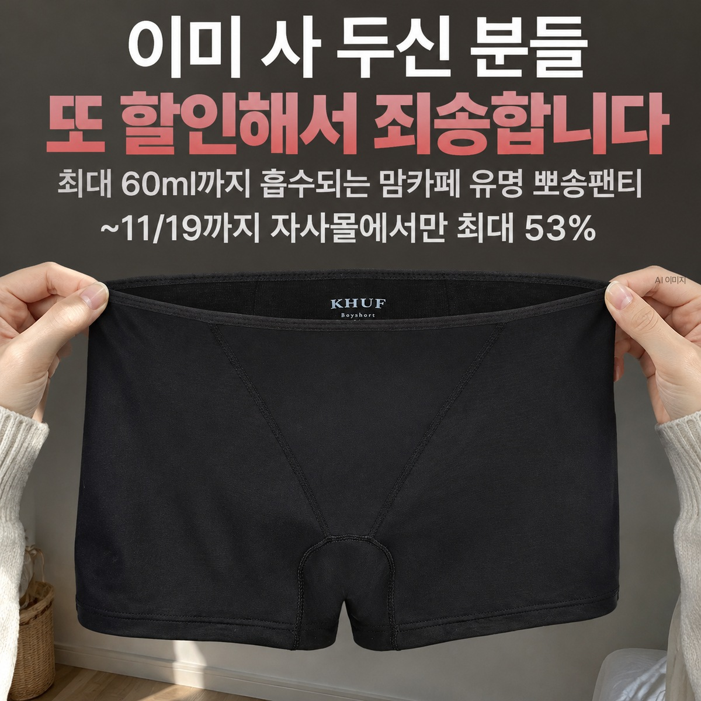
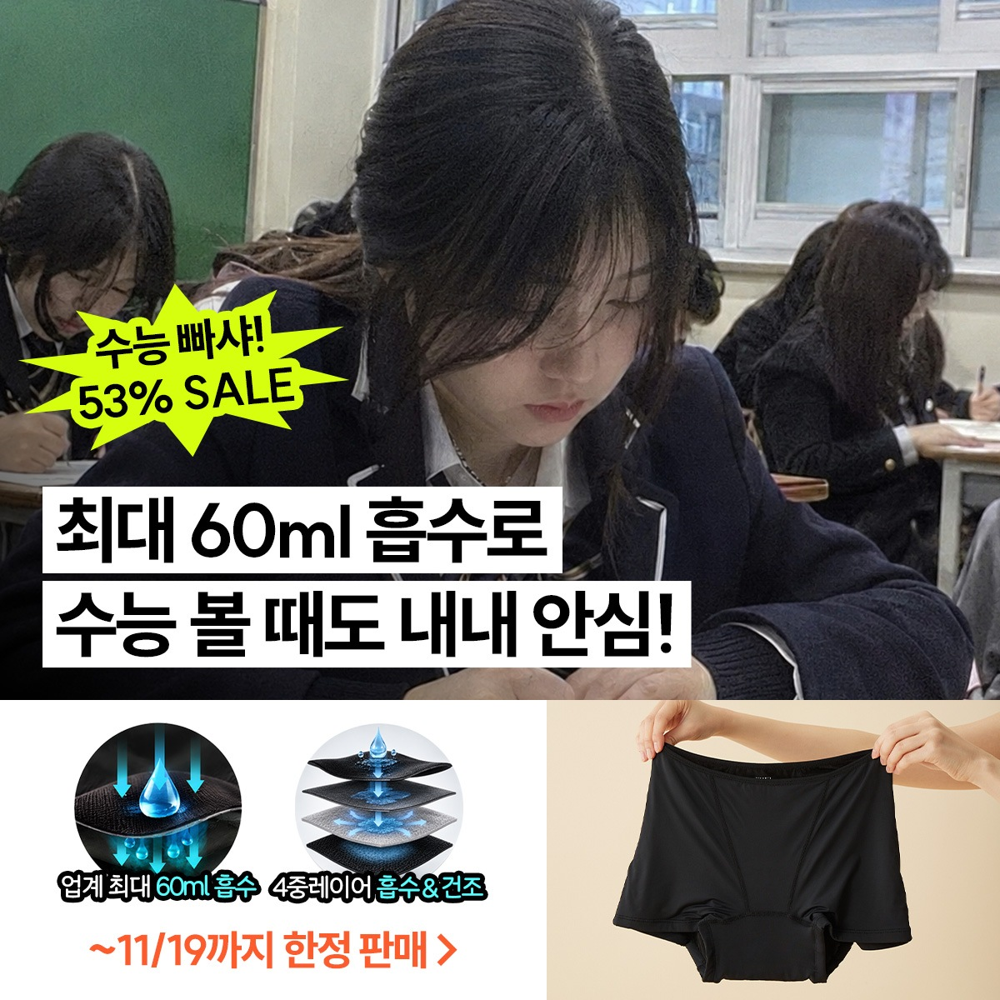

# 쿠프 META 상시 소재 리포트

**다음 제작은 위생팬티 ‘수능빠샤할인 5번’과 주니어브라 ‘둘째도같이’부터.** 위생팬티는 학교·학원에서 매일 입는 상황으로, 주니어브라는 두 아이에게 맞는 단계를 골라주는 이야기로 바꿉니다.

성과 기간은 2026년 11월 7~19일(한국시간)입니다. Meta 웹사이트 픽셀 구매 기준이며, 클릭 후 7일·조회 후 1일 기여를 적용했습니다.

## 위생팬티 1순위 · 수능빠샤할인 5번

| 소재 | 같은 광고의 Meta 성과 |
| --- | --- |
|  | **구매** 13건 · **CPA** 23,949원 · **ROAS** 548% · **광고비** 311,337원 · **구매매출** 1,707,572원 · **링크 클릭** 168회 · **링크 CTR** 1.24% |

피드 3번보다 링크 CTR이 높았고, 구매당 비용은 약 38% 낮았습니다. 제품 정면 구도를 살리고 ‘학교·학원 가는 날, 가방에 여벌 한 장’처럼 일상 장면을 앞에 둡니다. 행사 할인 문구·마감일은 교체합니다. 당시 할인 효과도 섞여 있어 상시 집행에서는 구매와 CPA를 다시 봅니다.

## 주니어브라 1순위 · 둘째도같이

| 소재 | 같은 광고의 Meta 성과 |
| --- | --- |
| [둘째도같이 세로 영상 재생](./media/2.mp4) · [둘째도같이 정방 영상 재생](./media/3.mp4) | **구매** 3건 · **CPA** 33,940원 · **ROAS** 266% · **광고비** 101,819원 · **구매매출** 271,200원 · **링크 클릭** 20회 · **링크 CTR** 0.80% |

두 아이에게 1·2단계를 각각 골라주는 이야기를 살립니다. 두 비율 모두 수능 언급과 11/19 종료 안내를 걷고, 기존과 같은 주니어브라 1단계 상품으로 연결해 봅니다. 행사 구매는 3건으로, 방향을 잡는 근거로 활용합니다.

## 위생팬티 후순위 · 수능빠샤 자사몰 피드 3번

| 소재 | 같은 광고의 Meta 성과 |
| --- | --- |
|  | **구매** 12건 · **CPA** 38,366원 · **ROAS** 233% · **광고비** 460,389원 · **구매매출** 1,073,500원 · **링크 클릭** 128회 · **링크 CTR** 0.99% |

행사 마지막 4일(11/16~19)은 157,476원 소진에 구매 0건이었습니다. 5번을 먼저 테스트하고, 3번을 후속 제작할 때는 교실 장면을 살려 ‘수업·자습으로 오래 앉아 있는 날’로 바꿉니다. 흡수량·레이어 문구는 상시 상품 페이지의 근거와 맞춰 확인합니다.

## 소재

[2.mp4 재생](./media/2.mp4)

[3.mp4 재생](./media/3.mp4)

